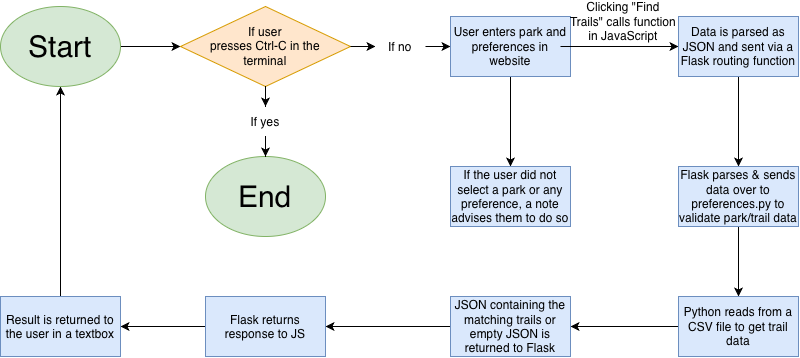

# TrailGenerator

Generates trails at national parks based on your location and preferred difficulty

## The Problem

It is often hard to find what trails you may want to go on. This site is intended to provide users with the highest-rated trails at whatever difficulty they prefer. 

## How It Works

- Program takes in data from a CSV file about various national parks and the highest rated trails at each location
- The site allows the user to pick between 15 total national parks
- Then, the user can specify what kind of difficulty and mileage they may want
- These preferences inform the program to return trails that relate to your designated preferences

## Tech Stack

- **Languages**: HTML/CSS, Python, JavaScript
- **External Tools**: Flask

## How to Use

Windows (Powershell):
- `python -m venv venv`
- `venv\Scripts\Activate.ps1`
- `pip install -r requirements.txt`
- `python TrailGenerator\app.py`

Windows (Command Shell):
- `python -m venv venv`
- `venv\Scripts\activate`
- `pip install -r requirements.txt`
- `python TrailGenerator\app.py`

MacOS/Linux:
- `python3 -m venv venv`
- `source venv/bin/activate`
- `pip install -r requirements.txt`
- `python TrailGenerator/app.py`

## Roadmap

- [x] Put all data in a CSV file manually
- [x] Use Python to break apart the CSV file
- [x] Get data from Python to JavaScript
- [x] Implement basic HTML page and CSS Styling using JavaScript function(s)
- [x] Adjust display of data and formatting (MVP)
- [x] Create Dropdown Bar with available National Parks

## Demo

## Note about Project

Originally, I planned to put in a geolocator into this project that would allow the user to enter in a location and the program would find a nearby national park (only the ones already in the csv) that was closest to that location. I ran out of time to undergo this part, but the core functionality that was planned for the MVP is all implemented. I ended up adding a dropdown bar as my final piece of this project.

## Author 

Xander Smits, [Github link](https://github.com/Puzzlevania86)

